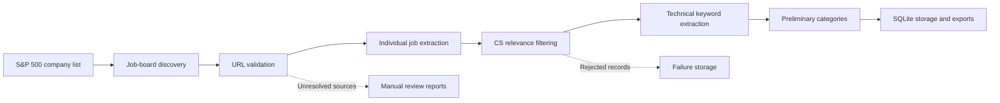

# TeachTrack II Industry Crawler

TeachTrack II is a university research project that connects academic Computer Science coursework with industry job requirements. This repository contains the **industry crawler**: tools for collecting company job-board sources, extracting individual job postings, retaining CS-relevant roles, and organizing their technical requirements into structured research data.

The separate [academic crawler](https://github.com/GeovanieVasquez/cs-scraper-build) collects academic information. The two projects are intended to contribute to a future knowledge graph connecting course topics and skills to employer requirements. Academic crawler integration and knowledge graph construction are future work; this repository currently produces industry datasets.

## Table of contents

- [Features](#features)
- [Architecture](#architecture)
- [Project structure](#project-structure)
- [Installation](#installation)
- [Usage](#usage)
- [Data and exports](#data-and-exports)
- [Testing](#testing)
- [Current project status](#current-project-status)
- [Limitations](#limitations)
- [Future development](#future-development)
- [Detailed documentation](#detailed-documentation)

## Features

| Capability | Implemented behavior |
| --- | --- |
| S&P 500 source collection | Imports a dated, commit-pinned constituent CSV, records provenance and a SHA-256 hash, and groups multiple share classes by issuer CIK with a normalized-name fallback. |
| Job-board discovery | Uses company article website links and observed career/job links to find candidate listing URLs within a bounded search budget. Failed discovery remains available for review. |
| URL validation | Checks HTTP(S) syntax, redirects, robots rules, accessible listing evidence and company identity; records resolved URLs, attempt timestamps, evidence and failure reasons. HTTP 200 alone is insufficient. |
| Platform detection | Recognizes Workday, Greenhouse, Lever, SmartRecruiters, iCIMS, Taleo, Oracle Recruiting, SAP SuccessFactors and Eightfold; other sites are labeled Custom. |
| Individual job extraction | Uses Workday list/detail APIs, Greenhouse descriptions and Lever postings; generic HTML supports JSON-LD `JobPosting` data and conservative individual-job heuristics. |
| CS relevance filtering | Scores technical titles, named technologies and technical concepts, rejects excluded occupations, and records a relevance score and explanation. The default threshold is `0.6`. |
| Technical keyword extraction | Extracts skills, technologies, education, responsibilities and requirements using predefined vocabularies and regex rules. Term boundaries reduce substring confusion such as Java versus JavaScript. |
| Preliminary categorization | Assigns one or more categories: AI, Software Engineering, Data, Cybersecurity, Cloud & Infrastructure, or Other. This is rule-based categorization, not trained ML clustering. |
| Deduplication | Uses company-scoped platform IDs, canonical posting URLs and fallback identity utilities; repeated accepted jobs update SQLite instead of creating another record. |
| Structured storage and exports | Saves accepted CS jobs transactionally in SQLite and exports JSON, CSV and JSON Lines; rejected records and crawl summaries are stored separately. |
| Automated tests | Deterministic tests cover source collection, validation, extraction adapters, relevance filtering, keywords, deduplication and storage. |

An independent `industry` spider also collects relevant company website pages using sitemap/link discovery and keyword scoring. Its industry-page records are separate from the CS job storage pipeline.

Detection does not imply a dedicated extraction adapter. Workday, Greenhouse and Lever have API adapters; the other platforms use generic HTML extraction. Optional Playwright rendering is implemented for HTML requests but is not required for API crawls. Source coverage, extraction across all companies, and end-to-end integration remain incomplete.

## Architecture



This diagram represents the research workflow. In the implementation, the jobs spider adds keyword/category fields during extraction, and the item pipeline calculates CS relevance before saving accepted records. Source collection and job extraction are separate commands connected through `company_sources.csv`; there is no automatic orchestration service. The jobs spider only restricts source statuses when `source_status` is explicitly supplied.

## Project structure

```text
TeachTrackII/
├── company_sources.csv          # Company metadata, listing URLs and validation evidence
├── requirements.txt             # Scrapy and development checks
├── requirements-sources.txt     # Source collection HTTP/parsing tools and checks
├── pyproject.toml               # Ruff and pytest configuration
├── scrapy.cfg                   # Scrapy project entry point
├── industry_crawler/
│   ├── sources/
│   │   ├── __main__.py           # import / discover / validate / report CLI
│   │   └── core.py               # Constituent import, discovery, HTTP validation and reports
│   ├── spiders/
│   │   ├── jobs.py               # Individual job extraction
│   │   ├── industry.py           # Independent industry-page crawler
│   │   ├── platforms.py          # Platform detection and API URL helpers
│   │   └── skill_categories.py   # Keywords, education, sections and categories
│   ├── cs_filter.py              # Explainable CS relevance scoring
│   ├── normalization.py          # Canonical URLs and job identities
│   ├── pipelines.py              # Job validation, filtering, deduplication and persistence
│   ├── storage.py                # SQLite storage and exports
│   ├── items.py                  # Job record schema
│   ├── settings.py               # Crawl limits, throttling and pipeline settings
│   ├── retry.py                  # Nonblocking retry backoff
│   ├── job_errors.py             # Extraction-error quarantine
│   ├── middlewares.py            # Scrapy middleware scaffold
│   └── demo.py                   # Offline replay of captured job fixtures
├── data/sp500/
│   ├── constituents.csv          # Saved upstream constituent snapshot
│   └── provenance.json           # Source commit, dates and hash
├── reports/sources/
│   ├── summary.json              # Source coverage and validation totals
│   ├── validation.csv            # All company validation records
│   └── manual-review.csv         # Every non-Verified company
├── tests/
│   ├── test_sources.py           # Mocked source collection/validation tests
│   ├── test_jobs.py              # Extraction, filtering and storage tests
│   └── fixtures/captured_jobs.json
└── docs/
    ├── source-collection.md      # Source discovery, validation and review workflow
    ├── job-crawler.md            # Job adapters, schema, filtering and restart behavior
    └── live-demo-summary.json    # Recorded October 2026 live prototype results
```

Runtime output directories under `data/` are generally Git-ignored. Root-level JSON captures such as `job_data.json` and `test.json` are historical outputs and should not be treated as current, validated CS-only datasets.

## Installation

Use **Python 3.11 or newer**, Git and Windows PowerShell. Run subsequent commands from the repository root with the virtual environment active.

```powershell
git clone https://github.com/kbc5796/TeachTrackII.git
Set-Location TeachTrackII
python -m venv .venv
.\.venv\Scripts\Activate.ps1
python -m pip install -r requirements.txt -r requirements-sources.txt
```

SQLite is included with Python. Install both requirements files to use the source collection tools and Scrapy spiders together.

If PowerShell prevents activation, run the same Python commands through `.\.venv\Scripts\python.exe` directly, for example:

```powershell
.\.venv\Scripts\python.exe -m pip install -r requirements.txt -r requirements-sources.txt
```

### Optional JavaScript rendering

For HTML sites that need browser rendering:

```powershell
python -m pip install scrapy-playwright
python -m playwright install chromium
```

Then add `-a render=true` to a `jobs` crawl. Rendering is opt-in; API requests do not request browser rendering, and the source discovery/validation CLI does not use Playwright. Browser rendering does not bypass access restrictions. Optional rendering has not been verified in the recorded live prototype.

## Usage

### 1. Import the S&P 500 companies

```powershell
python -m industry_crawler.sources import
```

The importer checks the latest commit affecting the constituent CSV in [datasets/s-and-p-500-companies](https://github.com/datasets/s-and-p-500-companies), rejects an upstream date older than 14 days, and saves the commit-pinned snapshot and provenance under `data/sp500/`. The upstream list is derived from Wikipedia and is not a licensed S&P feed. Existing source fields are merged into the new issuer list.

To import the saved snapshot without network access:

```powershell
python -m industry_crawler.sources import --offline
```

Offline import requires `data/sp500/constituents.csv` and `provenance.json` with a matching hash. Git line-ending conversion on Windows can change the checked-in CSV bytes and cause the integrity check to fail; generate a fresh local snapshot with the online importer before using `--offline` in that case.

Import, discovery and validation update `company_sources.csv`; source commands generate reports under `reports/sources/` by default. These operations can replace the recorded run's files. Use `--csv`, `--data-dir` and `--report-dir` to work with separate copies when preserving a snapshot.

### 2. Discover job-board URLs

```powershell
python -m industry_crawler.sources discover --workers 8 --timeout 8
```

Discovery follows published website/career links and records candidate URLs and provenance. A generic careers page is a navigation seed, not proof of an accessible job board. Discovery does not constitute fresh verification of a candidate.

### 3. Validate sources and generate reports

```powershell
python -m industry_crawler.sources validate --workers 8 --timeout 8
python -m industry_crawler.sources report
```

The CLI supports `Verified`, `Unverified`, `Needs Review`, `Blocked`, `Invalid` and `No Listings Found`. A verification timestamp records an attempt, including a missing-source check; it does not imply success. Review unresolved sources with:

```powershell
Import-Csv reports/sources/manual-review.csv | Select-Object company_name,ticker,source_status,failure_reason
```

Use `--only NVDA,MSFT` or `--limit 10` for a subset. Requests remain serial and delayed per origin even with multiple company workers; robots restrictions, rate limits and inaccessible robots policies are recorded rather than bypassed.

### 4. Run a small CS job crawl

```powershell
python -m scrapy crawl jobs -a only=NVDA -a source_status=Verified -a max_jobs=20 -a max_pages=10 -s CLOSESPIDER_TIMEOUT=100 -s JOB_OUTPUT_DIR=data/small-crawl
```

This selects NVIDIA from the current source CSV, requires its recorded source status to be Verified, and applies the CS pipeline. It does not guarantee current availability or 20 accepted CS jobs. `max_jobs` limits examined postings per company, including jobs later rejected by the filter; `max_pages` caps scheduled generic HTML pages.

### 5. Run a larger crawl and resume

```powershell
python -m scrapy crawl jobs -a source_status=Verified -a max_jobs=1000 -a max_pages=100 -s JOBDIR=data/checkpoints/full -s JOB_OUTPUT_DIR=data/full
```

Without `only`, this selects all companies whose recorded status is Verified. Source verification is not rerun automatically. Omitting `source_status` allows all source statuses, so keeping it explicit is recommended for research collection.

Stop gracefully with Ctrl+C once and rerun the same command to resume the persisted request queue. Keep the same sources and arguments for that checkpoint. For a new refresh, use a new `JOBDIR` and retain the output directory if you want accumulated jobs. Per-company counters reset on restart, so limits apply per process. Run only one crawler against each output/checkpoint directory.

Scrapy settings can tune concurrency, delays, timeouts and the CS threshold:

```powershell
python -m scrapy crawl jobs -a only=NVDA -a source_status=Verified -a max_jobs=20 -s CONCURRENT_REQUESTS=4 -s DOWNLOAD_DELAY=2 -s DOWNLOAD_TIMEOUT=30 -s CS_RELEVANCE_THRESHOLD=0.7 -s JOB_OUTPUT_DIR=data/tuned-crawl
```

Defaults include eight concurrent requests, one per domain, a one-second delay, AutoThrottle, a 30-second timeout and two retries with exponential backoff. Robots rules remain enabled.

### 6. Export job data

The jobs pipeline automatically exports the accumulated SQLite dataset when the spider closes. To additionally write a Scrapy feed of newly accepted records:

```powershell
python -m scrapy crawl jobs -a only=NVDA -a source_status=Verified -a max_jobs=20 -s JOB_OUTPUT_DIR=data/export-demo -O data/export-demo/new_jobs.json
```

Use `.csv` or `.jsonl` instead of `.json` for other Scrapy feed formats. `-O` overwrites that feed and includes newly accepted items from the current run; refreshed duplicates are saved in SQLite but dropped from the feed. Use `cs_jobs.*` for accumulated exports. There is no separate standalone export CLI.

### Offline demonstration

```powershell
python -m industry_crawler.demo --output data/fixture-demo
```

This replays captured fixtures through analysis, CS filtering and storage, including rejection and duplicate handling. It is an offline snapshot demonstration, not a fresh job crawl.

### Independent industry-page crawl

```powershell
python -m scrapy crawl industry -a only=NVDA,MSFT -a max_pages=15 -O data/industry-pages.json
```

This collects scored company website pages and keyword annotations. It does not use the jobs spider's CS relevance filter or SQLite job pipeline. The industry spider's default user-agent contains a contact placeholder; supply an appropriate research identifier with `-s USER_AGENT="TeachTrackII research crawler (contact: your-address)"` when deploying it.

## Data and exports

`company_sources.csv` contains company name, primary/all tickers, sector, CIK, website/career/listing URLs, detected platform, source status, provenance, verification attempt date, final URL, evidence and failure details.

Accepted job records include company metadata, platform, board URL, posting URL, job ID, title, location, employment type, description, responsibilities, requirements, skills, technologies, education, categories, AI indicators, CS score/reason and a UTC crawl timestamp. Descriptions are retained in full; responsibility/requirement section extraction is bounded. Source fields that are absent remain empty.

Each `JOB_OUTPUT_DIR` contains:

| File | Purpose |
| --- | --- |
| `jobs.sqlite3` | Authoritative incremental job and failure storage. |
| `cs_jobs.json` | Accumulated accepted CS jobs as a JSON array. |
| `cs_jobs.csv` | Tabular export; list/dict values are encoded as JSON strings. |
| `cs_jobs.jsonl` | One accepted job per line. |
| `crawl_failures.csv` | Rejected jobs, invalid items, board/industry pages and request/extraction errors. |
| `crawl_summary.json` | Stored-job/failure totals and available Scrapy run statistics. |

Accepted postings commit immediately. Export files are replaced atomically per file at spider close; after an interrupted run, SQLite is authoritative and another crawl regenerates exports. Different known job IDs remain distinct even if their titles or URLs match. Refreshes update observed postings but do not mark expired jobs as closed.

## Testing

```powershell
python -m pytest -q
python -m ruff check .
git diff --check
```

Pytest uses mocked HTTP/API responses and captured fixtures, with temporary storage for persistence tests. It covers constituent import and deduplication, CSV formatting, URL/platform detection, redirects, robots and validation statuses, job adapters, CS filtering, keyword boundaries, categories, duplicate updates and exports. Ruff configuration is in `pyproject.toml`; two unused-import exceptions apply to existing scaffold/industry files. Passing these checks does not establish live availability of every source or browser-rendering compatibility.

During this README update, Python 3.13 with Scrapy 2.19 ran **94 passing tests**. The repository-wide Ruff check reported two existing `E731` lambda-assignment violations in `tests/test_sources.py`; the documentation change does not fix or suppress them.

## Current project status

The source collection results below are from the **October 11, 2026 run**, using an October 9 upstream snapshot. They are historical research observations, not permanent live counts:

| Metric | Recorded result |
| --- | ---: |
| Unique S&P 500 companies | 500 |
| Tickers, including multiple share classes | 503 |
| Retained job-board/listing URLs | 202 |
| Verified job boards | 56 |
| Unresolved company sources | 444 |

The unresolved total includes 363 Needs Review, 43 Unverified, 34 Blocked and four No Listings Found; the run reported zero Invalid URLs. See the saved [source summary](reports/sources/summary.json), [full validation records](reports/sources/validation.csv) and [manual review queue](reports/sources/manual-review.csv). Missing-source records received an attempt timestamp, not a successful live HTTP verification.

The repository also contains a [recorded October 2026 job prototype](docs/live-demo-summary.json): 42 accepted CS postings from NVIDIA and Airbnb, out of 120 examined postings. This is saved evidence from that run; those jobs may no longer be available.

Both source collection and the CS job crawler are present on `main`. They share the source CSV, but verification coverage and reliable crawler integration across the full company list are ongoing. Approximately 500 verified job-board sources remains a target; it has not been achieved. Advanced AI/ML grouping, academic integration and a knowledge graph are not implemented.

## Limitations

- **JavaScript websites:** Source discovery/validation uses HTTP responses without browser rendering. The jobs spider has optional Playwright support, but it has not been verified in the recorded live prototype and does not guarantee extraction from every dynamic site.
- **Robots and access restrictions:** Disallowed paths, authentication, CAPTCHA challenges and blocked job boards can prevent collection. The tools do not attempt to bypass these protections.
- **Rate limiting and transient failures:** Delays, throttling and bounded retries reduce request pressure but cannot ensure access. Source validation suspends an origin after HTTP 429 for that run.
- **Platform coverage:** Detection covers more vendors than dedicated extraction. Other ATS platforms rely on generic HTML; unsupported layouts, alternate Workday tenant paths and API changes can require adapter work or manual review.
- **Unverified sources:** Candidate URLs can be inaccessible, stale or ambiguous. A source marked Verified is a dated observation and does not guarantee successful extraction or CS jobs on a later run. Discovery is bounded, and upstream freshness is checked by commit date rather than a licensed index feed.
- **CS filtering:** The score is a deterministic heuristic, not a probability or learned classifier. English title patterns, finite vocabularies, ambiguous roles and employer boilerplate can cause false positives or negatives. Company sector does not determine relevance.
- **Extraction and persistence:** Generic HTML follows same-host links within depth/page limits. Category and section extraction are heuristic, restart limits are per process, and expired-job reconciliation is not implemented.

## Future development

- Expand verified company source coverage and resolve the manual review queue.
- Improve extraction accuracy, ATS-specific adapters and source-to-crawler integration tests.
- Evaluate CS relevance and keyword quality against reviewed research samples.
- Develop advanced AI/ML job grouping beyond the current keyword categories.
- Integrate the separate academic crawler's course topics and skill data.
- Build a knowledge graph connecting academic concepts, technical skills and industry requirements.

## Detailed documentation

- [Source collection, validation and manual review](docs/source-collection.md)
- [CS job crawler, filtering, storage and restart behavior](docs/job-crawler.md)
- [Recorded source validation summary](reports/sources/summary.json)
- [Recorded live job prototype](docs/live-demo-summary.json)
- [Academic crawler repository](https://github.com/GeovanieVasquez/cs-scraper-build)

The detailed feature documents include development-time audits and recorded test/live-run evidence. Use the current implementation and saved reports when distinguishing those historical observations from present coverage.
